# OmniServices

OmniServices is a scalable, distributed backend platform built with NestJS, TypeScript, gRPC, and RabbitMQ in a pnpm monorepo architecture. It delivers modular services for e-commerce, authentication, social posts, media management, order lifecycle handling, multi-gateway payments, and search indexing.

---

## Architecture Overview

OmniServices follows the **Database-per-Service** microservices architecture pattern. The API Gateway acts as the public reverse proxy and entry point for HTTP/REST requests, routing requests to internal microservices via high-performance gRPC. Asynchronous events and background workflows are coordinated through RabbitMQ, while each service maintains its own isolated database.

```mermaid
flowchart TB
    Client(["Clients (Web / Mobile)"]) -->|REST / HTTPS| Gateway["API Gateway"]

    subgraph Services["Core Microservices"]
        direction TB
        Auth["Auth Service"]
        User["User Service"]
        Commerce["Commerce Service"]
        Order["Order Service"]
        Payment["Payment Service"]
        Post["Post Service"]
        Media["Media Service"]
        Search["Search Service"]
        Supplier["Supplier Service"]
        Notification["Notification Service"]
    end

    subgraph Messaging["Message Broker"]
        RabbitMQ{{"RabbitMQ Message Broker"}}
    end

    subgraph Storage["Databases & Storage (Database-per-Service)"]
        direction TB
        DB_Auth[("PostgreSQL (Auth)")]
        DB_User[("PostgreSQL (User)")]
        DB_Commerce[("PostgreSQL (Commerce)")]
        DB_Order[("PostgreSQL (Order)")]
        DB_Payment[("PostgreSQL (Payment)")]
        DB_Post[("PostgreSQL (Post)")]
        DB_Media[("PostgreSQL (Media)")]
        DB_Supplier[("PostgreSQL (Supplier)")]
        DB_Notif[("PostgreSQL (Notification)")]
        ES[("Elasticsearch")]
        Redis[("Redis Shared Cache")]
    end

    Gateway -->|gRPC| Auth
    Gateway -->|gRPC| User
    Gateway -->|gRPC| Commerce
    Gateway -->|gRPC| Order
    Gateway -->|gRPC| Payment
    Gateway -->|gRPC| Post
    Gateway -->|gRPC| Media
    Gateway -->|gRPC| Search
    Gateway -->|gRPC| Supplier

    Gateway -.->|Events| RabbitMQ
    Auth -.->|Events| RabbitMQ
    User -.->|Events| RabbitMQ
    Commerce -.->|Events| RabbitMQ
    Order -.->|Events / Saga| RabbitMQ
    Payment -.->|Events / IPN| RabbitMQ
    Post -.->|Events| RabbitMQ
    Supplier -.->|Events| RabbitMQ

    RabbitMQ -.->|Consume| Notification
    RabbitMQ -.->|Index Sync| Search
    RabbitMQ -.->|Payment Updates| Order

    Auth --- DB_Auth
    User --- DB_User
    Commerce --- DB_Commerce
    Order --- DB_Order
    Payment --- DB_Payment
    Post --- DB_Post
    Media --- DB_Media
    Supplier --- DB_Supplier
    Notification --- DB_Notif
    Search --- ES

    Gateway --- Redis
    Auth --- Redis

    classDef clientClass fill:#2d3748,stroke:#4a5568,stroke-width:2px,color:#fff;
    classDef gatewayClass fill:#1a365d,stroke:#2b6cb0,stroke-width:2px,color:#fff;
    classDef serviceClass fill:#234e52,stroke:#319795,stroke-width:1.5px,color:#fff;
    classDef brokerClass fill:#744210,stroke:#d69e2e,stroke-width:2px,color:#fff;
    classDef dbClass fill:#1c4532,stroke:#38a169,stroke-width:1.5px,color:#fff;

    class Client clientClass;
    class Gateway gatewayClass;
    class Auth,User,Commerce,Order,Payment,Post,Media,Search,Supplier,Notification serviceClass;
    class RabbitMQ brokerClass;
    class DB_Auth,DB_User,DB_Commerce,DB_Order,DB_Payment,DB_Post,DB_Media,DB_Supplier,DB_Notif,ES,Redis dbClass;
```



---

## Monorepo Structure & Service Documentation

Each service contains its own detailed `README.md` with module specifics, execution instructions, and architectural details:

```text
OmniServices/
├── apps/
│   ├── gateway/         # [apps/gateway/README.md](apps/gateway/README.md) - API Gateway & Swagger documentation
│   ├── auth/            # [apps/auth/README.md](apps/auth/README.md) - Authentication, authorization, tokens, and OAuth
│   ├── user/            # [apps/user/README.md](apps/user/README.md) - User accounts, profiles, and relationship graphs
│   ├── notification/    # [apps/notification/README.md](apps/notification/README.md) - Omnichannel email, SMS, push notifications
│   ├── post/            # [apps/post/README.md](apps/post/README.md) - Content publishing, feed operations, and social interactions
│   ├── search/          # [apps/search/README.md](apps/search/README.md) - Elasticsearch full-text search indexing & query engine
│   ├── media/           # [apps/media/README.md](apps/media/README.md) - Asset uploads, object storage, and media transformations
│   ├── commerce/        # [apps/commerce/README.md](apps/commerce/README.md) - Product catalog, carts, and checkout initiation
│   ├── supplier/        # [apps/supplier/README.md](apps/supplier/README.md) - Merchant onboarding, supplier inventory, vendor feeds
│   ├── product/         # [apps/product/README.md](apps/product/README.md) - Raw ingredient culinary catalog (WHO 8 groups), variant stock management & moderation
│   ├── order/           # [apps/order/README.md](apps/order/README.md) - Order lifecycle management, CQRS, and outbox choreography
│   └── payment/         # [apps/payment/README.md](apps/payment/README.md) - Multi-gateway payments (COD, Cards, VNPay, Momo) & IPN webhooks
├── libs/
│   ├── common/          # Shared utilities, decorators, guards, exceptions, filters
│   └── contracts/       # gRPC Protobuf definitions and shared DTO interfaces
├── .github/             # GitHub Actions CI/CD workflows, issue/PR templates, dependabot
├── Makefile             # Convenient targets for setup, execution, and testing
├── docker-compose.yml   # Multi-service infrastructure orchestration
└── package.json         # Workspace root and shared scripts
```

---

## Tech Stack

- **Runtime & Language**: Node.js, TypeScript
- **Framework**: NestJS
- **Inter-service Communication**: gRPC (Protobuf), RabbitMQ (AMQP)
- **Data & Storage**: PostgreSQL (Database-per-Service via Prisma ORM), Elasticsearch, Redis (caching and rate limiting)
- **Package Management**: pnpm (monorepo workspaces)
- **Code Quality**: ESLint, Prettier, TypeScript strict mode
- **Documentation**: Swagger / OpenAPI 3.0

---

## Getting Started

### Prerequisites

- Node.js 20.x or later
- pnpm 9.x or later (`corepack enable && corepack prepare pnpm@latest --activate`)
- Docker & Docker Compose
- Make (optional, recommended)

### 1. Installation

Clone the repository and install workspace dependencies:

```bash
git clone https://github.com/your-org/OmniServices.git
cd OmniServices
make install
```

### 2. Environment Configuration

Copy the example environment file:

```bash
cp .env.example .env
```

Ensure configuration values (database URLs, Redis port, RabbitMQ credentials) match your local environment.

### 3. Start Infrastructure

Boot backing services (PostgreSQL databases, Redis, RabbitMQ):

```bash
make docker-up
```

### 4. Database Setup

Generate Prisma client artifacts and sync database schemas:

```bash
make prisma-generate
make prisma-push
```

To seed the database with initial data:

```bash
make prisma-seed
```

---

## Running the Application

### Development Mode

Run specific microservices individually:

| Service              | Make Command              |                          Documentation Link |
| -------------------- | ------------------------- | ------------------------------------------: |
| API Gateway          | `make start-gateway`      |           [Gateway](apps/gateway/README.md) |
| Auth Service         | `make start-auth`         |                 [Auth](apps/auth/README.md) |
| User Service         | `make start-user`         |                 [User](apps/user/README.md) |
| Notification Service | `make start-notification` | [Notification](apps/notification/README.md) |
| Post Service         | `make start-post`         |                 [Post](apps/post/README.md) |
| Search Service       | `make start-search`       |             [Search](apps/search/README.md) |
| Media Service        | `make start-media`        |               [Media](apps/media/README.md) |
| Commerce Service     | `make start-commerce`     |         [Commerce](apps/commerce/README.md) |
| Supplier Service     | `make start-supplier`     |         [Supplier](apps/supplier/README.md) |
| Product Service      | `make start-product`      |           [Product](apps/product/README.md) |
| Order Service        | `make start-order`        |               [Order](apps/order/README.md) |
| Payment Service      | `make start-payment`      |           [Payment](apps/payment/README.md) |

To launch all services concurrently:

```bash
make start
```

---

## Testing & Quality Assurance

Ensure all code follows the strict quality standards before submitting contributions:

```bash
# Run linting (0 errors, 0 warnings policy)
make lint

# Run automated formatting
make format

# Run unit tests
make test

# Run end-to-end tests
make test-e2e
```

---

## API Documentation

When the API Gateway is running, interactive Swagger/OpenAPI documentation is available at:

```text
http://localhost:<GATEWAY_PORT>/docs
```

---

## Contributing & Security

- **Contributing Guide**: Please review [.github/CONTRIBUTING.md](.github/CONTRIBUTING.md) for branch naming, coding guidelines, and PR lifecycle.
- **Code of Conduct**: Community standards and pledges are outlined in [.github/CODE_OF_CONDUCT.md](.github/CODE_OF_CONDUCT.md).
- **Security Policy**: For vulnerability disclosures, refer to [.github/SECURITY.md](.github/SECURITY.md).
- **Pull Request Template**: Pre-merge checklist and change categorization are defined in [.github/PULL_REQUEST_TEMPLATE.md](.github/PULL_REQUEST_TEMPLATE.md).

---

## License

This project is proprietary and confidential. All rights reserved.
