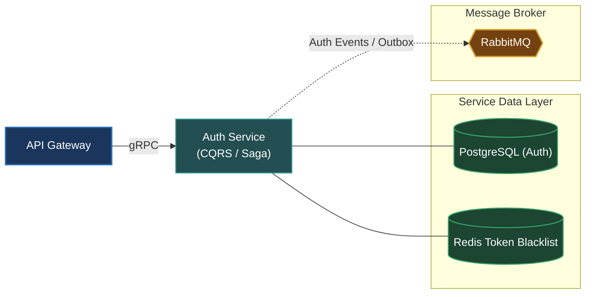

# Auth Service (`apps/auth`)

The Auth Service manages identity verification, authentication credentials, multi-factor authentication (MFA/OTP), session token issuance, and OAuth federations.

---

## Architecture & Responsibilities

- **Authentication & Tokens**: Issues, rotates, and invalidates JWT Access Tokens and Refresh Tokens.
- **Identity Lifecycle**: Manages credentials, password hashes (Argon2/Bcrypt), account activations, and password resets.
- **Enterprise Patterns**: Implements CQRS (Command Query Responsibility Segregation), Saga pattern for multi-step onboarding, and the Transactional Outbox pattern for reliable event publishing.
- **Protocol**: Serves synchronous remote procedure calls via **gRPC** (`auth.v1.AuthService`) and publishes audit events over **RabbitMQ**.



---

## Database & Persistence

- **Database**: PostgreSQL (dedicated instance for `auth`)
- **ORM**: Prisma ORM (`prisma/schema.prisma`)
- **Cache**: Redis for token blacklisting, refresh token family rotation, and rate-limiting brute force attempts.

---

## Local Development

Start the Auth Service in development watch mode:

```bash
# From workspace root
make start-auth
# or
pnpm --filter @omni/auth run start:dev
```

Run database migrations:

```bash
pnpm --filter @omni/auth run prisma:push
```

---

## Relation to Root Architecture

For overall system architecture and cross-service orchestration, refer to the [Root README.md](../../README.md).
