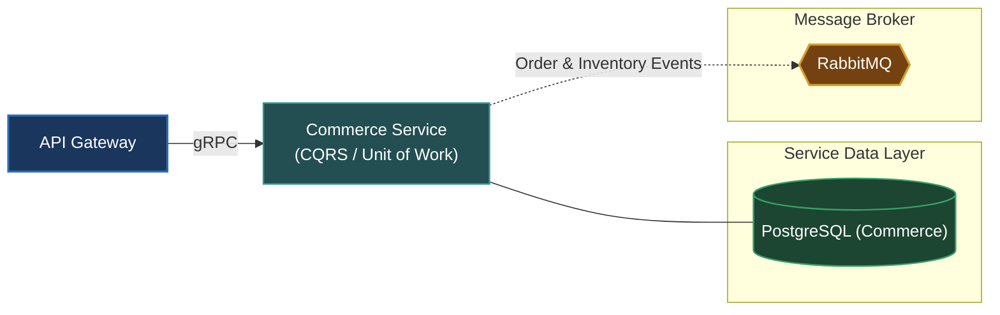

# Commerce Service (`apps/commerce`)

The Commerce Service is responsible for core business logic relating to products, pricing, inventories, shopping carts, orders, and payment checkout flows.

---

## Architecture & Responsibilities

- **Product & Catalog**: Manages categories, variants, pricing, and stock levels.
- **Order Processing**: Orchestrates multi-step order placement, status transitions, and inventory reservation.
- **Enterprise Patterns**: Implements CQRS (Command/Query separation), Unit of Work for transactional checkout safety, and publishes domain events upon state changes.
- **Protocol**: Serves synchronous requests via **gRPC** and coordinates event-driven interactions via **RabbitMQ**.



---

## Database & Persistence

- **Database**: PostgreSQL (dedicated instance for `commerce`)
- **ORM**: Prisma ORM (`prisma/schema.prisma`)

---

## Local Development

Start the Commerce Service in development watch mode:

```bash
# From workspace root
make start-commerce
# or
pnpm --filter @omni/commerce run start:dev
```

Run database migrations:

```bash
pnpm --filter @omni/commerce run prisma:push
```

---

## Relation to Root Architecture

For overall system architecture and cross-service orchestration, refer to the [Root README.md](../../README.md).
