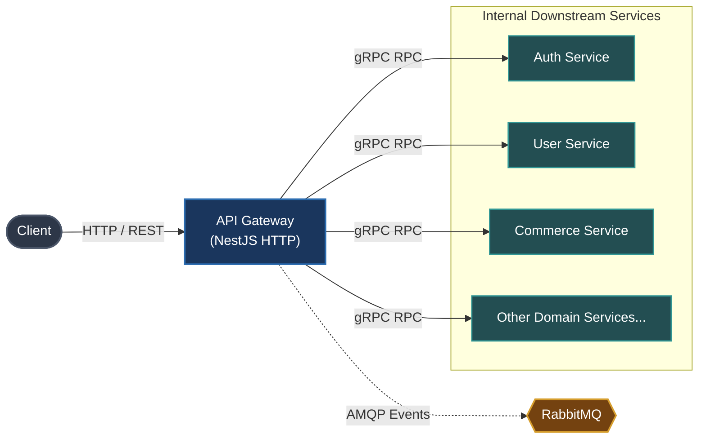

# API Gateway (`apps/gateway`)

The API Gateway is the central reverse proxy and single public entry point for all client applications (Web, Mobile, Third-party integrations) interacting with OmniServices.

---

## Architecture & Responsibilities

- **Reverse Proxy & Routing**: Translates incoming public HTTP/REST and WebSocket requests into internal gRPC calls or asynchronous RabbitMQ event publications.
- **Authentication & Authorization**: Validates incoming JWT access tokens, manages session state, and protects endpoints using global and route-level guards.
- **API Documentation**: Exposes interactive Swagger / OpenAPI 3.0 documentation aggregated across the entire platform.
- **Traffic Management & Security**: Enforces rate limiting, Helmet security headers, CORS policies, payload validation, and request tracing via OpenTelemetry / Jaeger.



---

## Key Modules

- `src/modules/auth`: Proxies authentication endpoints (sign in, sign up, token refresh, OAuth).
- `src/modules/user`: Proxies profile queries, account mutations, and relationship graphs.
- `src/modules/post`: Content publishing, feeds, and post interactions.
- `src/modules/commerce`: Product browsing, cart management, and order checkouts.
- `src/modules/search`: Global search indexing queries powered by Elasticsearch.
- `src/modules/media`: Multipart file uploads and media URL resolution.

---

## Local Development

Start the API Gateway in development watch mode:

```bash
# From workspace root
make start-gateway
# or
pnpm --filter @omni/gateway run start:dev
```

Swagger API documentation will be available at:

```text
http://localhost:<GATEWAY_PORT>/docs
```

---

## Relation to Root Architecture

For overall system architecture and cross-service orchestration, refer to the [Root README.md](../../README.md).
