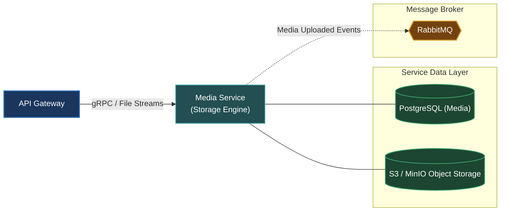

# Media Service (`apps/media`)

The Media Service handles binary file uploads, object storage operations, image resizing, and CDN asset management for OmniServices.

---

## Architecture & Responsibilities

- **File Management**: Ingests images, videos, and documents, validates MIME types and file signatures, and coordinates storage lifecycle.
- **Storage Abstraction**: Adapters for local filesystem storage, AWS S3, or MinIO object stores.
- **Protocol**: Serves metadata retrieval and upload authorization (pre-signed URLs) via **gRPC**, and emits media processing events over **RabbitMQ**.



---

## Database & Persistence

- **Database**: PostgreSQL (dedicated instance for `media` metadata)
- **ORM**: Prisma ORM (`prisma/schema.prisma`)
- **Object Storage**: S3-compatible cloud or local storage.

---

## Local Development

Start the Media Service in development watch mode:

```bash
# From workspace root
make start-media
# or
pnpm --filter @omni/media run start:dev
```

Run database migrations:

```bash
pnpm --filter @omni/media run prisma:push
```

---

## Relation to Root Architecture

For overall system architecture and cross-service orchestration, refer to the [Root README.md](../../README.md).
