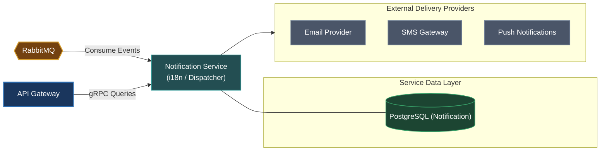

# Notification Service (`apps/notification`)

The Notification Service is an asynchronous event consumer responsible for delivering transactional messages, emails, SMS, and in-app alerts to users.

---

## Architecture & Responsibilities

- **Omnichannel Dispatch**: Formats and delivers notifications via Email (SMTP/SES), SMS, push notifications, and in-app feeds.
- **Template & Localization**: Renders multi-language notification templates (`templates/`, `i18n/`).
- **Event-Driven Processing**: Subscribes to topics across the system on RabbitMQ (e.g. user welcome emails, order confirmations, password reset codes, comment notifications).
- **Protocol**: Consumes messages asynchronously from **RabbitMQ** and exposes gRPC endpoints for notification preferences and history queries.



---

## Database & Persistence

- **Database**: PostgreSQL (dedicated instance for `notification`)
- **ORM**: Prisma ORM (`prisma/schema.prisma`)

---

## Local Development

Start the Notification Service in development watch mode:

```bash
# From workspace root
make start-notification
# or
pnpm --filter @omni/notification run start:dev
```

Run database migrations:

```bash
pnpm --filter @omni/notification run prisma:push
```

---

## Relation to Root Architecture

For overall system architecture and cross-service orchestration, refer to the [Root README.md](../../README.md).
