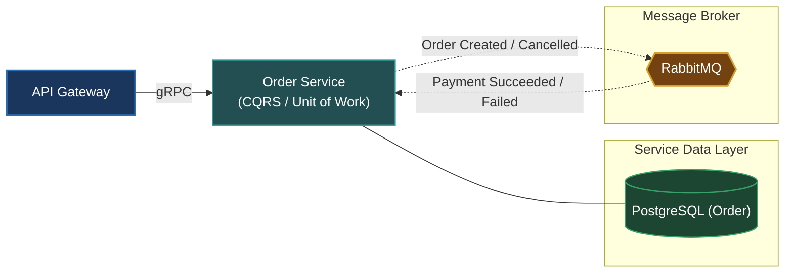

# Order Service (`apps/order`)

The Order Service manages the complete lifecycle of customer orders in OmniServices, decoupling order processing from shopping carts and catalog browsing.

---

## Architecture & Responsibilities

- **Order Lifecycle Management**: Handles order placement, status state machine transitions (`AWAITING_PAYMENT`, `CONFIRMED`, `PROCESSING`, `SHIPPING`, `DELIVERED`, `COMPLETED`, `CANCELLED`, `REFUNDED`).
- **CQRS & Unit of Work**: Segregates write operations (commands) from read projections (queries) with atomic transaction boundaries via `PrismaOrderUnitOfWork`.
- **Transactional Outbox & Choreography Saga**: Persists domain events into `outbox_events` within the database transaction, published to RabbitMQ to coordinate asynchronously with Payment and Notification services.
- **Protocols**: Exposes high-performance unary RPCs via **gRPC** (port `50057`) and consumes saga reply events over **RabbitMQ** (`order_queue`).



---

## Database & Persistence

- **Database**: PostgreSQL (dedicated database `omni_service_order` on port `5445`)
- **ORM**: Prisma ORM (`prisma/schema.prisma`)
- **Tables**: `orders`, `order_items`, `outbox_events`

---

## Local Development

Start the Order Service in development watch mode:

```bash
# From workspace root
make start-order
# or
pnpm --filter @omni/order run start:dev
```

Run database migrations:

```bash
pnpm --filter @omni/order run prisma:push
```

---

## Relation to Root Architecture

For overall system architecture and cross-service orchestration, refer to the [Root README.md](../../README.md).
