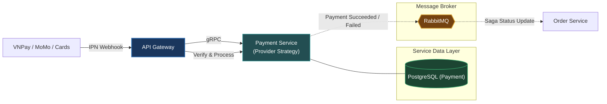

# Payment Service (`apps/payment`)

The Payment Service handles electronic payment gateways, multi-provider checkout routing, webhook IPN callbacks, and transactional refunds.

---

## Architecture & Responsibilities

- **Multi-Gateway Routing**: Extensible provider strategy supporting **COD**, **CREDIT_CARD** (Visa/Mastercard 3DS sandbox), **VNPAY** (HMAC-SHA512 checksum), and **MOMO** (HMAC-SHA256 signature).
- **IPN / Webhook Security**: Secure cryptographic verification of incoming IPN notifications from payment gateways before state transitions.
- **Transactional Choreography Saga**: Publishes `payment.succeeded`, `payment.failed`, `payment.cod_pending`, and `payment.refunded` to RabbitMQ with PostgreSQL outbox backup.
- **Protocols**: Unary RPC calls via **gRPC** (port `50058`) and asynchronous messaging via **RabbitMQ** (`payment_queue`).



---

## Database & Persistence

- **Database**: PostgreSQL (dedicated database `omni_service_payment` on port `5446`)
- **ORM**: Prisma ORM (`prisma/schema.prisma`)
- **Tables**: `payment_transactions`, `outbox_events`

---

## Local Development

Start the Payment Service in development watch mode:

```bash
# From workspace root
make start-payment
# or
pnpm --filter @omni/payment run start:dev
```

Run database migrations:

```bash
pnpm --filter @omni/payment run prisma:push
```

---

## Relation to Root Architecture

For overall system architecture and cross-service orchestration, refer to the [Root README.md](../../README.md).
