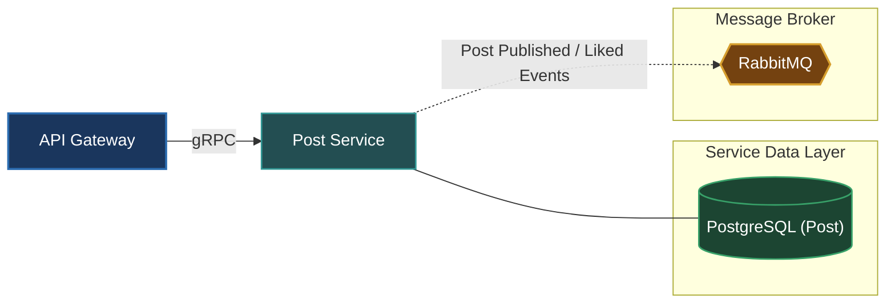

# Post Service (`apps/post`)

The Post Service provides social publishing, feed generation, content tagging, comments, and engagement tracking for OmniServices.

---

## Architecture & Responsibilities

- **Content Management**: Manages post authoring, drafts, updates, deletion, and media attachment references.
- **Engagement & Interactions**: Tracks likes, reactions, shares, and comment threads.
- **Protocol**: Serves synchronous requests via **gRPC** and publishes content creation/interaction events to **RabbitMQ** for real-time feed fan-out, search indexing, and notifications.



---

## Database & Persistence

- **Database**: PostgreSQL (dedicated instance for `post`)
- **ORM**: Prisma ORM (`prisma/schema.prisma`)

---

## Local Development

Start the Post Service in development watch mode:

```bash
# From workspace root
make start-post
# or
pnpm --filter @omni/post run start:dev
```

Run database migrations:

```bash
pnpm --filter @omni/post run prisma:push
```

---

## Relation to Root Architecture

For overall system architecture and cross-service orchestration, refer to the [Root README.md](../../README.md).
