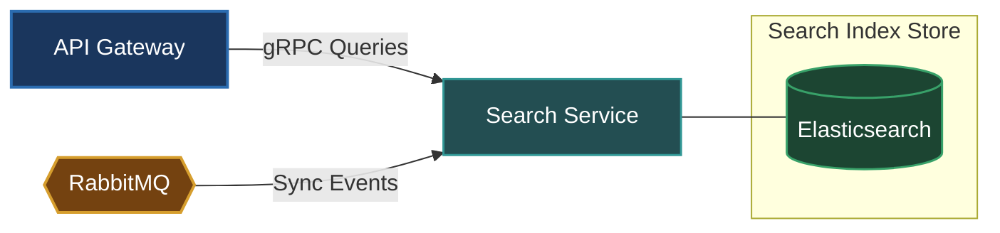

# Search Service (`apps/search`)

The Search Service provides full-text search indexing, multi-criteria filtering, and autocompletion queries across users, posts, products, and categories.

---

## Architecture & Responsibilities

- **Full-Text Search Engine**: Integrates directly with Elasticsearch to handle typo-tolerant queries, fuzzy searching, aggregations, and relevancy scoring.
- **Event-Driven Indexing**: Listens to RabbitMQ event streams emitted by `user`, `post`, and `commerce` services to keep Elasticsearch indices synchronized in real-time.
- **Protocol**: Serves low-latency search queries to the API Gateway via **gRPC** and consumes indexing events from **RabbitMQ**.



---

## Data & Persistence

- **Primary Store**: Elasticsearch (dedicated search engine node)
- **Indices**: User index, Post index, Product catalog index.

---

## Local Development

Start the Search Service in development watch mode:

```bash
# From workspace root
make start-search
# or
pnpm --filter @omni/search run start:dev
```

---

## Relation to Root Architecture

For overall system architecture and cross-service orchestration, refer to the [Root README.md](../../README.md).
