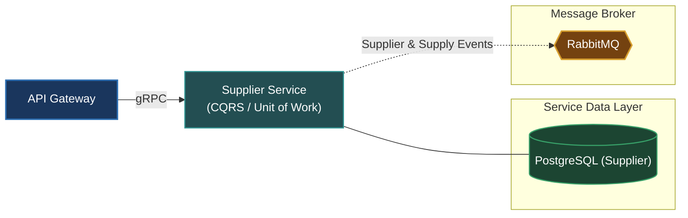

# Supplier Service (`apps/supplier`)

The Supplier Service manages merchant onboarding, supplier contracts, catalog syndication, and fulfillment vendor inventories.

---

## Architecture & Responsibilities

- **Supplier Onboarding**: Handles business profiles, merchant verification, agreements, and vendor accounts.
- **Inventory & Supply Management**: Manages supplier product feeds, wholesale pricing tiers, and warehouse distribution points.
- **Enterprise Patterns**: Implements CQRS (Command/Query separation) and Unit of Work for transactional inventory consistency.
- **Protocol**: Serves synchronous calls via **gRPC** and coordinates vendor operations over **RabbitMQ**.



---

## Database & Persistence

- **Database**: PostgreSQL (dedicated instance for `supplier`)
- **ORM**: Prisma ORM (`prisma/schema.prisma`)

---

## Local Development

Start the Supplier Service in development watch mode:

```bash
# From workspace root
make start-supplier
# or
pnpm --filter @omni/supplier run start:dev
```

Run database migrations:

```bash
pnpm --filter @omni/supplier run prisma:push
```

---

## Relation to Root Architecture

For overall system architecture and cross-service orchestration, refer to the [Root README.md](../../README.md).
