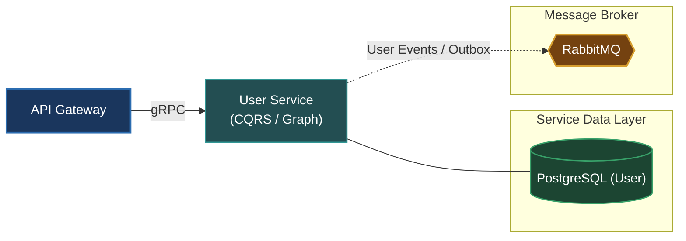

# User Service (`apps/user`)

The User Service handles user profile management, identity metadata, relationship graphs (following, followers, blocks), and user settings across OmniServices.

---

## Architecture & Responsibilities

- **Profile Management**: CRUD operations for user profiles, avatars, bios, and account preferences.
- **Social Graph**: Manages directional follow relationships, friendships, and block lists.
- **Enterprise Patterns**: Implements CQRS (Command Handlers for state mutations, Query Handlers for reads), Unit of Work for transactional integrity, and Transactional Outbox for event dispatching.
- **Protocol**: Serves synchronous requests via **gRPC** (`user.v1.UserService`) and dispatches user lifecycle events to **RabbitMQ**.



---

## Database & Persistence

- **Database**: PostgreSQL (dedicated instance for `user`)
- **ORM**: Prisma ORM (`prisma/schema.prisma`)

---

## Local Development

Start the User Service in development watch mode:

```bash
# From workspace root
make start-user
# or
pnpm --filter @omni/user run start:dev
```

Run database migrations:

```bash
pnpm --filter @omni/user run prisma:push
```

---

## Relation to Root Architecture

For overall system architecture and cross-service orchestration, refer to the [Root README.md](../../README.md).
